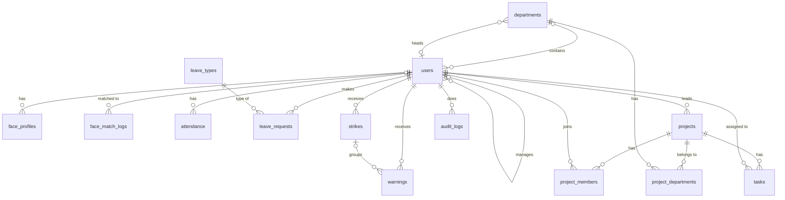

# ERD: HR & Attendance System (v1, after edits)

Database: MySQL. 15 tables, plus Laravel's technical tables (sessions, password_reset_tokens, cache, jobs, migrations). All timestamps are stored in UTC.

## Key decisions
- `users` holds everyone: Admin, HR, and employees. The Admin has no department, job title, hire date, or salary (null).
- Archiving a person sets `users.archived_at`. It also revokes their face profile and erases the embedding, and deletes their rows in `sessions`.
- Archivable tables: users, departments, leave_types, projects, tasks. Nothing is deleted. The only rows that are removed: project_members and project_departments (history stays in audit_logs), and face embeddings (set to null).
- All foreign keys are RESTRICT. Nothing cascades.
- Calculated, never stored: leave balance, project progress, the overdue flag, and strike deduction totals.
- Stored: the attendance status, because changing Settings must not rewrite old days.
- Never return a User model directly from the API. Use API Resources: `password` is always hidden, and `salary` is shown only to HR or the Admin (for their targets) and to the owner.

## 1. Diagram

`settings` has no relations (one row).

## 2. Tables

### users
| Column | Type | Notes |
|---|---|---|
| id | bigint PK | |
| name | varchar | |
| email | varchar, unique | |
| password | varchar | hidden |
| role | enum(admin, hr, employee) | |
| department_id | bigint FK departments, null | null only for the Admin |
| manager_id | bigint FK users, null | not itself, no cycles, must be hr or employee |
| job_title | varchar, null | required when role is hr or employee |
| hire_date | date, null | required when role is hr or employee |
| contract_start | date, null | |
| contract_end | date, null | |
| salary | decimal(10,2), null | required when role is hr or employee. Changes are in audit_logs. |
| phone | varchar, null | |
| address | varchar, null | |
| must_change_password | boolean | true for new and reset accounts |
| archived_at | timestamp, null | archived users cannot log in |
| created_at, updated_at | timestamp | |

### departments
| Column | Type | Notes |
|---|---|---|
| id | bigint PK | |
| name | varchar, unique | |
| head_id | bigint FK users, null | must belong to this department, and be hr or employee |
| archived_at | timestamp, null | |
| created_at, updated_at | timestamp | |

### face_profiles
| Column | Type | Notes |
|---|---|---|
| id | bigint PK | |
| user_id | bigint FK users | |
| face_embedding | longtext, null | encrypted cast, hidden in the model, never in list queries or API responses. Null while pending, and erased when revoked. |
| model_name | varchar, null | set when activated |
| model_version | varchar, null | set when activated |
| status | enum(pending, active, revoked) | pending: consent given, waiting for a good capture. active: enrolled. revoked: replaced, reset by HR, or the user was archived. |
| consent_at | timestamp | |
| consent_version | varchar | the version of the consent text |
| enrolled_at | timestamp, null | set when activated |
| created_at, updated_at | timestamp | |

- A user is "Enrolled" when they have a row with status active.
- At most one pending or active row per user. Laravel enforces it, or add a unique index on `(user_id, is_current)` where `is_current` is a virtual column equal to 1 for pending or active, and null for revoked.

### face_match_logs
| Column | Type | Notes |
|---|---|---|
| id | bigint PK | |
| user_id | bigint FK users, null | null when the face was not recognized |
| matched | boolean | |
| score | float, null | |
| created_at | timestamp | cleaned after `match_log_retention_days`. No images are stored. |

### attendance (one row per person per working day)
| Column | Type | Notes |
|---|---|---|
| id | bigint PK | |
| user_id | bigint FK users | |
| date | date | unique with user_id |
| come_in | datetime, null | the first pass of the day |
| get_out | datetime, null | the last out. Empty means the person is inside, or has not left. |
| break_minutes | int | default 0 |
| status | enum(present, late, absent, on_leave, holiday) | stored, calculated by the AttendanceCalculator, never typed in |
| verification_method | enum(face, manual) | manual once HR creates or edits the row |
| edited_by | bigint FK users, null | the last HR editor |
| edit_reason | varchar, null | required when edited |
| edited_at | timestamp, null | |
| no_checkout | boolean | default false. Set by the daily job when come_in exists and get_out is empty. |
| needs_review | boolean | default false. Set when a pass exists on an approved leave day. |
| created_at, updated_at | timestamp | |

- **Direction from the door:** no row means in. A row with an empty `get_out` means out (fill `get_out`). A row with a filled `get_out` means back from a break: `break_minutes` increases by (now minus `get_out`), then `get_out` is cleared.
- **HR fixes a day by editing the times and the break,** with a reason. The status recalculates, and the old and new values go to audit_logs. Validation: `come_in` is before `get_out`, and `break_minutes` is not more than the time between them.
- **The status is calculated** on the first pass, after every edit, and when the daily job closes the day.
- **The daily job** runs only for hr and employee users, on working days. It creates the missing rows: absent (no pass, no leave), on_leave (approved leave), or holiday.

### leave_types
| Column | Type | Notes |
|---|---|---|
| id | bigint PK | |
| name | varchar, unique | seeded: Full day off, Leave early |
| unit | enum(day, time) | day for Full day off, time for Leave early |
| yearly_allowance | int | days or times per year |
| archived_at | timestamp, null | |
| created_at, updated_at | timestamp | |

### leave_requests
| Column | Type | Notes |
|---|---|---|
| id | bigint PK | |
| user_id | bigint FK users | |
| leave_type_id | bigint FK leave_types | |
| start_date | date | |
| end_date | date | same year as start_date |
| leave_time | time, null | only for Leave early |
| amount | smallint | working days, or 1 for a time. The server calculates it at request time. |
| note | varchar, null | |
| status | enum(pending, approved, rejected, cancelled) | |
| decided_by | bigint FK users, null | |
| decided_at | timestamp, null | |
| decision_comment | varchar, null | |
| created_at, updated_at | timestamp | |

- Balance = `yearly_allowance` minus the sum of `amount` of approved requests in that year.

### warnings
| Column | Type | Notes |
|---|---|---|
| id | bigint PK | |
| user_id | bigint FK users | |
| reason | varchar | |
| date | date | |
| issued_by | bigint FK users | |
| strike_id | bigint FK strikes, null | set when the warning is part of a strike |
| revoked_at | timestamp, null | |
| revoked_by | bigint FK users, null | |
| revoked_reason | varchar, null | required when revoked |
| created_at, updated_at | timestamp | |

### strikes
| Column | Type | Notes |
|---|---|---|
| id | bigint PK | |
| user_id | bigint FK users | |
| amount | decimal(10,2) | copied from settings when created |
| revoked_at | timestamp, null | |
| revoked_by | bigint FK users, null | null when revoked automatically |
| revoked_reason | varchar, null | for example "warning revoked" |
| created_at, updated_at | timestamp | |

### projects
| Column | Type | Notes |
|---|---|---|
| id | bigint PK | |
| name | varchar | |
| description | text, null | |
| lead_id | bigint FK users | automatically a member, must be hr or employee |
| created_by | bigint FK users | |
| start_date | date | |
| due_date | date | |
| status | enum(not_started, in_progress, on_hold, completed, cancelled) | |
| archived_at | timestamp, null | |
| created_at, updated_at | timestamp | |

### project_departments
| Column | Type | Notes |
|---|---|---|
| project_id | bigint FK projects | PK is both columns |
| department_id | bigint FK departments | |

### project_members
| Column | Type | Notes |
|---|---|---|
| project_id | bigint FK projects | PK is both columns |
| user_id | bigint FK users | must be hr or employee |

### tasks
| Column | Type | Notes |
|---|---|---|
| id | bigint PK | |
| project_id | bigint FK projects | |
| title | varchar | |
| assignee_id | bigint FK users | must be a project member |
| due_date | date, null | |
| status | enum(todo, in_progress, done) | |
| created_by | bigint FK users | |
| archived_at | timestamp, null | not counted in progress |
| created_at, updated_at | timestamp | |

### audit_logs
| Column | Type | Notes |
|---|---|---|
| id | bigint PK | |
| actor_id | bigint FK users, null | null for system jobs |
| action | varchar | for example salary_changed, attendance_edited, task_status_changed |
| entity | varchar | user, project, attendance, leave_request... |
| entity_id | bigint | |
| details | json | old and new values |
| created_at | timestamp | |

- The project activity feed is `entity = 'project'` with `entity_id` = the project id. Task and member events use the same, with `details.task_id`.
- Salary history is `entity = 'user'` with `action = 'salary_changed'`.

### settings (one row, the Admin edits it, HR reads it)
| Column | Type | Notes |
|---|---|---|
| id | bigint PK | |
| work_start_time | time | |
| work_end_time | time | must be after the start time |
| grace_period_minutes | int | |
| working_days | json | for example [1,2,3,4,5] |
| timezone | varchar | |
| holidays | json | list of {date, name} |
| overtime_min_minutes | int | |
| warnings_per_strike | tinyint | 3 |
| strike_amount | decimal(10,2) | 50.00 |
| currency_code | varchar(3) | the currency for salary and strikes |
| face_match_threshold | decimal(4,3) | |
| face_consent_version | varchar | the current consent text version |
| match_log_retention_days | int | |

The door device secret and the face service secret go in `.env`, not in the database.

## 3. Indexes
- users: unique(email), index(department_id), index(manager_id), index(role, archived_at).
- face_profiles: index(user_id, status).
- face_match_logs: index(created_at), index(user_id).
- attendance: unique(user_id, date), index(date, status).
- leave_requests: index(user_id, start_date), index(status).
- warnings: index(user_id, revoked_at, strike_id).
- strikes: index(user_id).
- projects: index(status), index(due_date).
- tasks: index(project_id, status), index(assignee_id).
- audit_logs: index(entity, entity_id), index(actor_id), index(created_at).

## 4. Rules the database can't enforce (Laravel checks them)
- Rows for people (attendance, leave, warnings, strikes, project members, project lead, task assignee, department head, manager) must belong to a user whose role is hr or employee. The Admin is excluded from all of them.
- When role is hr or employee, `department_id`, `job_title`, `hire_date`, and `salary` are required.
- A department head belongs to that department. A manager is not the user themselves, and there are no manager cycles.
- A project lead is automatically a project member. A task assignee must be a project member. A member with open tasks cannot be removed.
- A leave request cannot overlap another active request, cannot exceed the balance, and stays within one calendar year.
- Policy checks: the target's role, and actor is not equal to target.
- A strike is created inside a transaction when the 3rd free active warning is added. Revoking a warning of a strike revokes that strike, and sets `strike_id` to null on its other warnings.
- Archiving a user revokes their face profile and erases the embedding, and deletes their rows in `sessions`.

## 5. Migration order
1. departments (without `head_id`).
2. users (with the `department_id` foreign key and the `manager_id` self reference).
3. Add `departments.head_id` and its foreign key (this breaks the circular reference).
4. settings, leave_types.
5. face_profiles, face_match_logs, attendance.
6. leave_requests.
7. strikes, warnings.
8. projects, project_departments, project_members, tasks.
9. audit_logs.
- Laravel's own tables come from the default migrations, `php artisan session:table`, and the jobs and cache migrations.

## 6. Seeds
- The first Admin user (role admin, no department).
- One settings row.
- The two leave types: Full day off and Leave early.